<!-- Header -->
<p align="center">
  
</p>

<p align="center">
  <a href="https://github.com/kvnlhm">
    
  </a>
</p>

<p align="center">
  
</p>

<p align="center">
  
  
  
  
</p>

---

## 👋 About Me

> *I delegate to AI agents, review their work, and occasionally remind them that "done" includes testing.*

- 🛠️ **Full-Stack & AI Engineer** building web applications, GIS platforms, and AI-powered business tools.
- 🧘‍♂️ **Ascended Vibe Coder**: I set the direction, give agents context, inspect the changes, and check the results.
- 🧠 I build document-grounded chatbots, shopping assistants, analysis workflows, guardrails, API integrations, and human handoff.
- 🔍 My agents help with planning, implementation, debugging, review, and testing. "It runs" is usually where the follow-up questions begin.
- 📍 Based in **Surabaya, Indonesia**. [Portfolio](https://kevinilham.vercel.app) · [LinkedIn](https://www.linkedin.com/in/kvnlhm/)

## 📜 Career Evolution

| The Manual Era 💀 | The Ascended Vibe Coder Era 🧘‍♂️✨ |
| :-- | :-- |
| Writing the boilerplate myself | Delegating the boilerplate, then reviewing what came back |
| Explaining a bug to a rubber duck | Explaining a bug to an agent that can confidently introduce another one |
| Reviewing a teammate's pull request | Reviewing an agent's pull request. Same questions, different colleague. |
| Keeping the architecture in my head | Writing it down so the next agent doesn't invent a new one |
| Asking "did you test it?" | Still asking "did you test it?" |
| "One last change" before shipping | "One last change" across several context windows |

## 🛠️ Tech Stack

**Coding Agents & Editors**

<p>
  
  
  
  
  
  
  
</p>

**Languages & Frameworks**

<p>
  
  
  
  
  
  
  
  
  
  
  
</p>

**AI, Maps & Automation**

LLM APIs: **Anthropic / Claude · Google Gemini · OpenRouter · Groq**

Knowledge ingestion · retrieval-augmented generation (RAG) · guardrails · structured outputs · human handoff

LangGraph · n8n · Leaflet · Mapbox · GeoJSON

**Tools & Infra**

<p>
  
  
  
  
  
  
  
</p>

## 🧬 The Vibe Coder Manifesto

1. **Brief the agents.** "Build the app" is a wish. Requirements give them something to work with.
2. **Read the changes.** The green checkmark is encouraging. I would also like to see what changed.
3. **Ask for evidence.** "All tests pass" is better with the command and its output attached.
4. **Own the result.** The agents get system prompts. I still get the bug reports.

## 📊 Daily Time Allocation

*A highly unofficial estimate. "One more thing" is difficult to time.*

```text
Briefing agents & providing context  ████████ 40%
Reviewing changes & asking for tests ██████   30%
Debugging code and AI confidence     ████     20%
Saying "one more thing"              ██       10%
```

## ⚡ Quick Status

| | |
| :-- | :-- |
| 🔭 **Currently working on** | Web apps, useful AI features, and workflows that survive a fresh context window |
| 💬 **Ask me about** | Full-stack development, AI integrations, Web GIS, and getting coding agents to finish the last 10% |
| 🎯 **Current goal** | Ship work that still behaves after the demo |
| ⚡ **Fun fact** | I have several AI colleagues. Apparently, I am still on debugging duty. |

## 📈 Activity

<p align="center">
  
</p>

<p align="center">
  <picture>
    <source media="(prefers-color-scheme: dark)" srcset="https://raw.githubusercontent.com/kvnlhm/kvnlhm/output/snake-dark.svg" />
    
  </picture>
</p>

---

<p align="center">
  
</p>

<p align="center">
  <sub>Powered by AI agents, human review, and "one more thing." ✨</sub>
</p>
